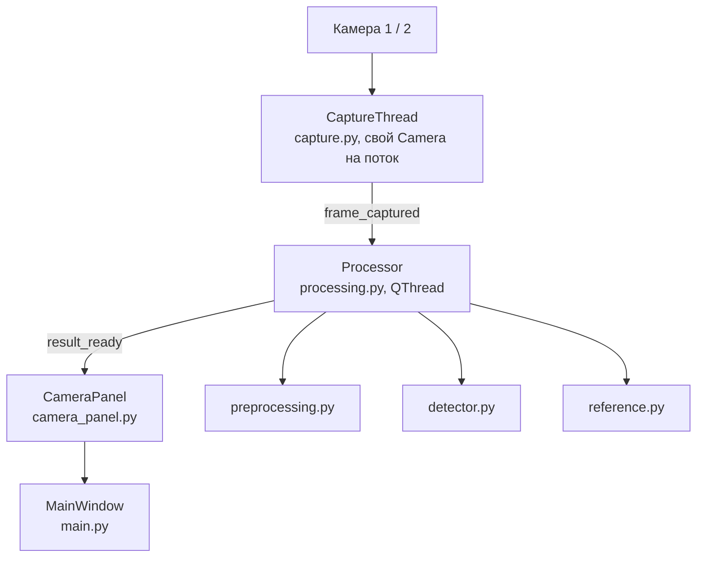
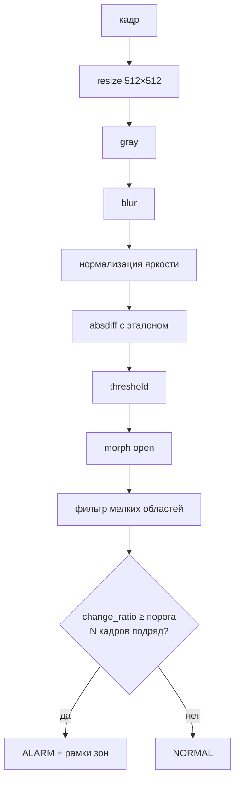

# rpi-vision

Система обнаружения изменений в кадре с камеры. Разработка ведётся на Windows
(USB-камера через OpenCV), целевая платформа — Raspberry Pi (CSI-камера через Picamera2).

## Как это работает

Камер столько, сколько задано `config.CAMERA_COUNT` (1 или 2). Всё, что ниже,
у каждой камеры своё: поток захвата, хендл камеры, эталон, область интереса,
кнопки и статусы. Общие только порог тревоги (слайдер), кнопка **Refresh**
и входы GPIO.





- Эталон — медиана `REFERENCE_FRAMES` кадров, задаётся кнопкой **Set reference**.
- **Detect change** — ручная проверка изменений по последним кадрам.
- **Select area** — режим выделения области интереса мышкой: тянем рамку по
  превью, кадр кропается до неё (доли кадра, у каждой камеры своя область),
  изменение вне области тревогу не даёт. **Set reference** сам включает этот
  режим и снимает эталон с нарисованной области. Смена области сбрасывает
  эталон — задайте заново. Область хранится в долях кадра, новое выделение
  идёт по текущему кадру: чтобы вернуть полный обзор, выделите рамкой всё превью.
- **Settings...** у каждой панели — правка параметров камеры (см. ниже).
- Все параметры алгоритма — в `config.py`.

## Параметры камеры (V4L2)

Те же команды, что и руками в консоли, только при каждом открытии камеры:

```
v4l2-ctl -d /dev/video0 -c auto_exposure=1 -c exposure_absolute=300
```

- Всё перечисляемое в `config.V4L2_CONTROLS`: ключ — индекс камеры, значение —
  `{контрол: значение}`. Порядок важен: авторежимы (`auto_exposure`,
  `white_balance_temperature_auto`) ставятся первыми, иначе камера вернёт
  авторежим и затрёт ручные экспозицию/баланс белого.
- Прописывается при открытии камеры (бэкенд `opencv`). Для этой камеры
  `LOCK_CAMERA_PARAMS` не применяется: он включает автоэкспозицию через OpenCV
  и затёр бы V4L2-значения.
- Контрола, которого нет на камере, пропускается с предупреждением в лог.
- Требуется пакет `v4l-utils` (`sudo apt install v4l-utils`), в нём `v4l2-ctl`.
  Без него программа работает как раньше, кнопка **Settings...** объясняет, чего не хватает.
- Кнопка **Settings...** показывает реальные контролы камеры с их диапазонами и
  текущими значениями (меню — выпадающим списком, read-only/неактивные —
  заблокированы). Кнопка **Apply** применяет значения к камере, пишет их в
  `config.V4L2_CONTROLS` и в `camera_settings.json`; файл перекрывает конфиг при
  следующем запуске. Удалил `camera_settings.json` — снова действуют значения
  из `config.py`.

## Запуск (Windows / dev)

Требуется Python 3.14 и [uv](https://docs.astral.sh/uv/):

```
uv sync
uv run main.py
```

Камера выбирается в выпадающем списке над каждым полем превью, общий список
обновляется кнопкой **Refresh**. Лог — `app.log` (очищается при каждом запуске).

## Несколько камер

`config.CAMERA_COUNT = 1` (по умолчанию) или `2` — столько полей превью будет
в окне. У каждого поля своя камера, свой эталон, своя область интереса и свои
кнопки.

- При старте панели разбирают доступные камеры по порядку (первая — камера 0,
  вторая — камера 1), дальше индекс выбирается вручную в выпадающем списке над
  полем. Если камер меньше, чем панелей, лишняя панель показывает
  «Camera not available» и оживает по кнопке **Refresh**, когда камера появится.
- Ширина поля: `PREVIEW_WIDTH` делится между панелями, но не уже `MIN_PANEL_WIDTH`
  (380 px) — иначе три кнопки в ряд не поместятся. Окно шире `PREVIEW_WIDTH + 150`.
- Порог тревоги (слайдер) общий для всех камер; `change_ratio` у каждой считается
  от площади её области.

## Запуск на Raspberry Pi

```
sudo apt install python3-picamera2 python3-opencv python3-pyside6.qtwidgets
uv venv --system-site-packages   # чтобы venv видел apt-пакеты
uv sync
uv run main.py
```

- `picamera2` и `opencv` ставим через apt: pip-сборки на ARM тяжёлые и конфликтуют с libcamera.
- В `config.py`: `CAMERA_BACKEND = "picamera2"` (или оставить `auto`) и `LOCK_CAMERA_PARAMS = True` — фиксация экспозиции/баланса белого (на Windows выключена: роняет FPS).
- Калибровка `PIXEL_THRESHOLD` / `MIN_AREA`: включить `DEBUG = True` — снимки этапов пайплайна сохраняются в `debug/`.

## Автозапуск при загрузке системы

`config.AUTORUN = True` — при старте программа пишет systemd-юнит
`/etc/systemd/system/rpi-vision.service` и делает `systemctl enable`, так что
после перезагрузки приложение поднимается само.

```
sudo -E uv run main.py     # первый запуск с правами root (нужны sudo -n при записи юнита)
```

- Юнит описывает текущий запуск (тот же интерпретатор и каталог), поэтому после
  переезда или пересоздания venv достаточно перезапустить программу — юнит
  перепишется сам.
- Нужен `DISPLAY`: берётся из окружения, иначе `config.AUTORUN_DISPLAY`
  (на Raspberry Pi OS это X11, `:0`). Без него Qt не подключится к дисплею.
- Снять автозапуск: `uv run python -c "import autorun; autorun.disable()"`.
- Логи запуска из-под systemd — `journalctl -u rpi-vision`.
