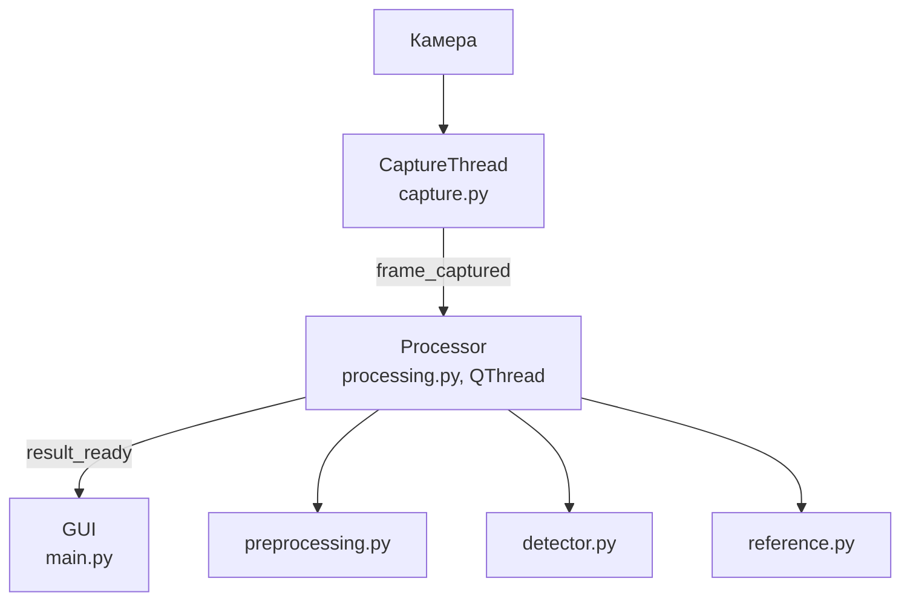
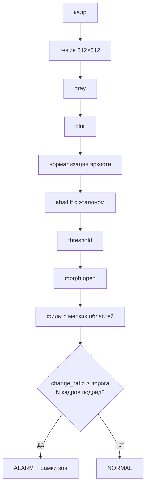

# rpi-vision

Система обнаружения изменений в кадре с камеры. Разработка ведётся на Windows
(USB-камера через OpenCV), целевая платформа — Raspberry Pi (CSI-камера через Picamera2).

## Как это работает





- Эталон — медиана `REFERENCE_FRAMES` кадров, задаётся кнопкой **Set reference**.
- **Detect change** — ручная проверка изменений по последним кадрам.
- **Select area** — режим выделения области интереса мышкой: тянем рамку по
  превью, кадр кропается до неё (`config.ROI`, доли кадра), изменение вне
  области тревогу не даёт. **Set reference** сам включает этот режим и снимает
  эталон с нарисованной области. Смена области сбрасывает эталон — задайте заново.
  Область хранится в долях кадра, новое выделение идёт по текущему кадру: чтобы
  вернуть полный обзор, выделите рамкой всё превью.
- Все параметры алгоритма — в `config.py`.

## Запуск (Windows / dev)

Требуется Python 3.14 и [uv](https://docs.astral.sh/uv/):

```
uv sync
uv run main.py
```

Камера выбирается в выпадающем списке в окне, список обновляется кнопкой
**Refresh**. Лог — `app.log` (очищается при каждом запуске).

## Запуск на Raspberry Pi

```
sudo apt install python3-picamera2 python3-opencv python3-pyside6.qtwidgets
uv venv --system-site-packages   # чтобы venv видел apt-пакеты
uv sync
uv run main.py
```

- `picamera2` и `opencv` ставим через apt: pip-сборки на ARM тяжёлые и конфликтуют с libcamera.
- В `config.py`: `CAMERA_BACKEND = "picamera2"` (или оставить `auto`) и `LOCK_CAMERA_PARAMS = True` — фиксация экспозиции/баланса белого (на Windows выключена: роняет FPS).
- Калибровка `PIXEL_THRESHOLD` / `MIN_AREA`: включить `DEBUG = True` — снимки этапов пайплайна сохраняются в `debug/`.

## Автозапуск при загрузке системы

`config.AUTORUN = True` — при старте программа пишет systemd-юнит
`/etc/systemd/system/rpi-vision.service` и делает `systemctl enable`, так что
после перезагрузки приложение поднимается само.

```
sudo -E uv run main.py     # первый запуск с правами root (нужны sudo -n при записи юнита)
```

- Юнит описывает текущий запуск (тот же интерпретатор и каталог), поэтому после
  переезда или пересоздания venv достаточно перезапустить программу — юнит
  перепишется сам.
- Нужен `DISPLAY`: берётся из окружения, иначе `config.AUTORUN_DISPLAY`
  (на Raspberry Pi OS это X11, `:0`). Без него Qt не подключится к дисплею.
- Снять автозапуск: `uv run python -c "import autorun; autorun.disable()"`.
- Логи запуска из-под systemd — `journalctl -u rpi-vision`.
